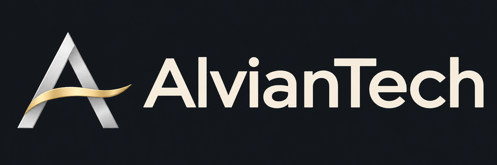

# Ricky Jones
**AlvianTech**

I build and test software that checks permission just before an AI system acts.

The objects named below are reference demonstrations, not production enforcement.

**Start with Commit Gate Core.** It checks whether a decision authorises these exact bytes and returns authorisation or refusal without applying the payload.

[Inspect the tested preview](https://github.com/LalaSkye/commit-gate-core/tree/610d155232fbc3f590ed40656e48403ef4d20dcf) · [Run the two checks](https://github.com/LalaSkye/commit-gate-core/blob/9a118ff97fbf68bcd154550c8c5d0fd27b7f0b47/REPRODUCE.md)

GitHub’s **Latest** release, `v0.1.1`, is the earlier callback-capable version.

> **Where does the system physically stop?**

Public GitHub is an inspection surface. Evidence does not transfer between objects.

### Public inspection and commissioned work

You’re welcome to run the published tests and share what you find. For an independent reproduction, please include the commit SHA, your environment, the commands you ran and the results. The licence in each repository governs reuse of its published materials.

If you’d like a new test, an integration or a review of your own system, let’s agree the scope, fee and what each of us can share before work starts. Access to unpublished implementation details is agreed separately.

## Three public inspection objects

These are the admitted public inspection class. They remain separately inspectable.

### When can a write change a record?

[start-here](https://github.com/LalaSkye/start-here) — bounded inspection object containing two separate local proof objects. The original decision/commit demo and the measured-write fixture support separate claims.

*Limit:* It is not currently designated as the public starting point. On the demonstrated path, no state mutation without a valid decision record.

[See what happens when a write is allowed or refused](#see-what-happens-when-a-write-is-allowed-or-refused)

### Does the decision cover these exact bytes?

[commit-gate-core](https://github.com/LalaSkye/commit-gate-core) — authorize-only kernel. Binds exact payload bytes to a scoped, fresh, one-use DecisionRecord and returns authorisation or refusal.

*Limit:* It does not apply the payload. An authorisation return is not an observed resource mutation.

### Does the policy still stand, and is it active in the engine?

[obligation-bound-policy-admission-lab](https://github.com/LalaSkye/obligation-bound-policy-admission-lab) — single-engine reference harness. Historical policy admission ≠ current standing ≠ observed active state.

*Limit:* Not a gate. A receipt is not automatically evidence of observed active engine state.

Do not inherit proofs across them.

## See what happens when a write is allowed or refused

[Inspect the measured-write fixture](https://github.com/LalaSkye/start-here/blob/2b1723b96ac2d73c28d112e17b1c07ed9caa6b91/README.md#measured-mutation-fixture)

This example uses one in-memory record and one tested write path. The `start-here` fixture reads the same resource before and after the attempt.

- **Authorised test:** The record moved from version 1 to version 2. One write.
- **Missing decision record:** The record stayed at version 1. The write function was called zero times.

[Inspect the authorised test](https://github.com/LalaSkye/start-here/blob/2b1723b96ac2d73c28d112e17b1c07ed9caa6b91/tests/test_core/test_measured_mutation.py#L91) · [Inspect the missing-decision-record test](https://github.com/LalaSkye/start-here/blob/2b1723b96ac2d73c28d112e17b1c07ed9caa6b91/tests/test_core/test_measured_mutation.py#L124)

## Secondary index

[inspection-surface](https://lalaskye.github.io/inspection-surface/) — routing index only. Not a fourth inspection object. PATHS_RESOLVE is not a successful test replay.

## Documented downstream reuse

CAGE credits adaptation of the NoDirectBind TLA+ safety invariant and BFS state-space enumerator from [LalaSkye/no-direct-bind](https://github.com/LalaSkye/no-direct-bind).

Attribution: [NOTICE](https://github.com/google/cybernetic-agent-governance-engine/blob/main/NOTICE) · [Adaptation record](https://github.com/google/cybernetic-agent-governance-engine/tree/main/third_party/no-direct-bind)  
Upstream source: [7fe9ff9](https://github.com/LalaSkye/no-direct-bind/commit/7fe9ff99636798accd5e04136991e1d3d3079417)

**Boundary:** Documented reuse, not endorsement or evidence of production deployment. CAGE is not an officially supported Google product.

`no-direct-bind` remains outside the three-object inspection class. Its proofs are model-local; they do not transfer to the objects above.

## Limits

Unless explicitly stated in the named object, these artefacts do not prove production readiness, compliance, enterprise deployment, operational adoption beyond the documented reuse above, path-universal governance, or full architecture disclosure.

Repository-level authorship and contribution statements are recorded in each object. GitHub timestamps establish public possession; they do not establish novelty or priority.

**Contact:** [linkedin.com/in/ricky-jones-trinityos](https://www.linkedin.com/in/ricky-jones-trinityos)  
**Status:** active research and engineering work.
