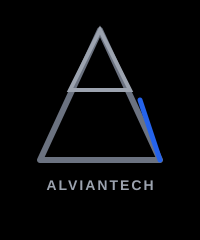

  

# Ricky Jones
**AlvianTech**

When an AI system says "yes", something real may happen next: a write, a payment, a message. I build and test controls that check permission before those actions go ahead.

[See one write allowed and one refused](#see-what-happens-when-a-write-is-allowed-or-refused)

The objects named below are reference demonstrations, not production enforcement.

**Public routing status:** Under revalidation. No repository is currently designated as the public starting point.

> **Where does the system physically stop?**

Public GitHub is an inspection surface. Evidence does not transfer between objects.

## See what happens when a write is allowed or refused

[Inspect the measured-write fixture](https://github.com/LalaSkye/start-here/blob/2b1723b96ac2d73c28d112e17b1c07ed9caa6b91/README.md#measured-mutation-fixture)

This example uses one in-memory record and one tested write path.

- **Authorised example:** The record moved from version 1 to version 2. One write.
- **Missing-record test:** The record stayed at version 1. The write function was called zero times.

[Inspect the separate missing-record test](https://github.com/LalaSkye/start-here/blob/2b1723b96ac2d73c28d112e17b1c07ed9caa6b91/tests/test_core/test_measured_mutation.py#L124)

## Three public inspection objects

These are the admitted public inspection class. They remain separately inspectable.

- [start-here](https://github.com/LalaSkye/start-here) — bounded inspection object containing two separate local proof objects.  
  *Limit:* It is not currently designated as the public starting point. On the demonstrated path, no state mutation without a valid decision record.

- [commit-gate-core](https://github.com/LalaSkye/commit-gate-core) — authorize-only kernel. Binds exact payload bytes to a scoped, fresh, one-use DecisionRecord and returns authorisation or refusal.  
  *Limit:* It does not apply the payload. An authorisation return is not an observed resource mutation.

- [obligation-bound-policy-admission-lab](https://github.com/LalaSkye/obligation-bound-policy-admission-lab) — single-engine reference harness. Historical policy admission ≠ current standing ≠ observed active state.  
  *Limit:* Not a gate. A receipt is not automatically evidence of observed active engine state.

Do not inherit proofs across them.

## Secondary index

[inspection-surface](https://lalaskye.github.io/inspection-surface/) — routing index only. Not a fourth inspection object. PATHS_RESOLVE is not a successful test replay.

## Documented downstream reuse

CAGE credits adaptation of the NoDirectBind TLA+ safety invariant and BFS state-space enumerator from [LalaSkye/no-direct-bind](https://github.com/LalaSkye/no-direct-bind).

Attribution: [NOTICE](https://github.com/google/cybernetic-agent-governance-engine/blob/main/NOTICE) · [Adaptation record](https://github.com/google/cybernetic-agent-governance-engine/tree/main/third_party/no-direct-bind)  
Upstream source: [7fe9ff9](https://github.com/LalaSkye/no-direct-bind/commit/7fe9ff99636798accd5e04136991e1d3d3079417)

**Boundary:** Documented reuse, not endorsement or evidence of production deployment. CAGE is not an officially supported Google product.

`no-direct-bind` remains outside the three-object inspection class. Its proofs are model-local; they do not transfer to the objects above.

## Limits

Unless explicitly stated in the named object, these artefacts do not prove production readiness, compliance, enterprise deployment, operational adoption beyond the documented reuse above, path-universal governance, or full architecture disclosure.

Repository-level authorship and contribution statements are recorded in each object. GitHub timestamps establish public possession; they do not establish novelty or priority.

**Contact:** [linkedin.com/in/ricky-jones-trinityos](https://www.linkedin.com/in/ricky-jones-trinityos)  
**Status:** active research and engineering work.
